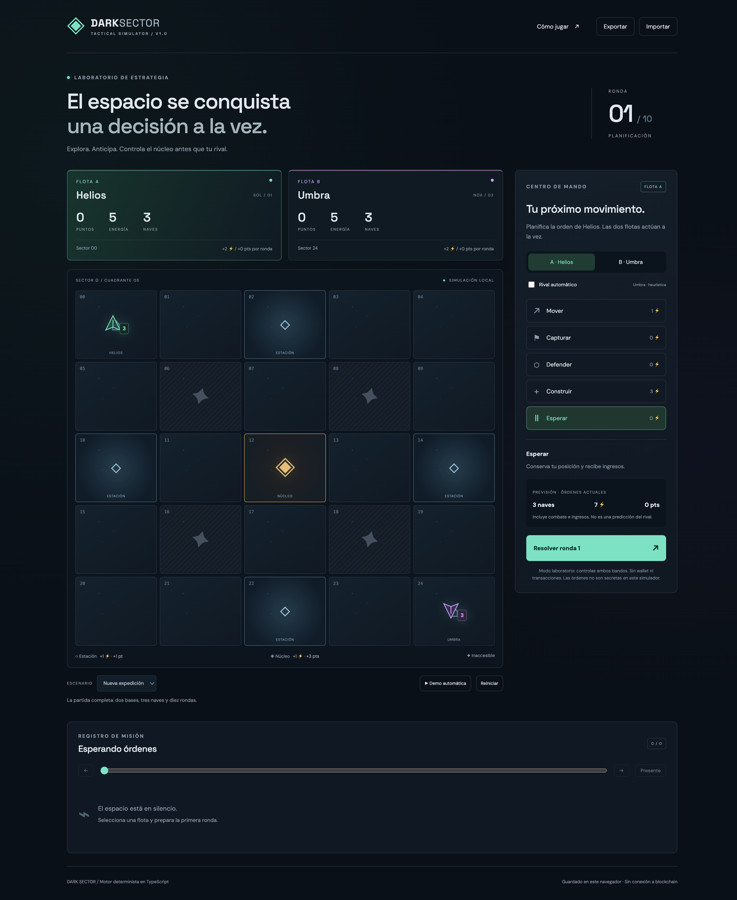
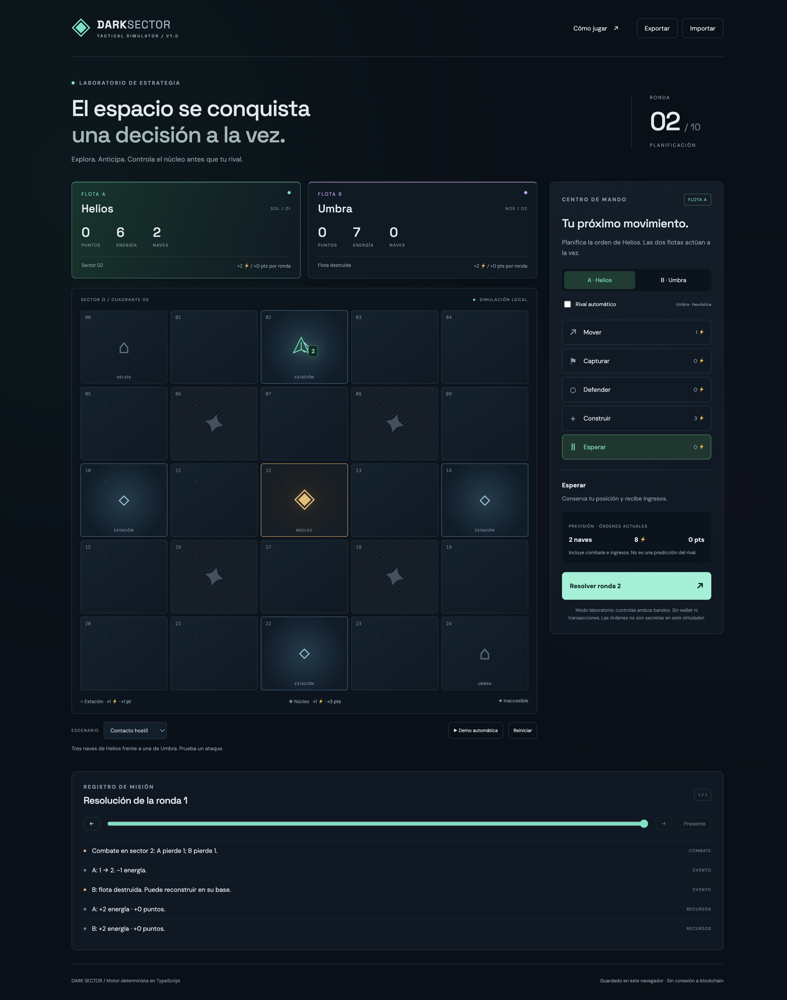
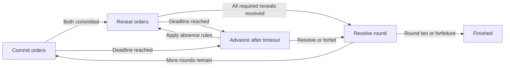

# Dark Sector

**A deterministic space strategy game built in Solidity, with simultaneous orders, commit–reveal gameplay, and an independently implemented TypeScript simulator.**

Two players command fleets across a contested 5 × 5 map. Over ten rounds, they capture energy stations, fight for the central core, and balance fleet construction against territorial expansion. The smart contract resolves the game; the local simulator makes its rules visible and testable.

The main engineering focus is **consistent state transitions**: the same starting state and orders should produce the same outcome in Solidity and TypeScript, regardless of which player reveals first.

## Simulator preview



*The local simulator combines the tactical board, fleet resources, order selection, and a round-by-round timeline. The interface currently uses Spanish labels.*

## Highlights

- **Simultaneous orders:** players commit to an order before revealing it, preventing them from changing their decision after seeing the opponent's reveal.
- **Deterministic combat:** movement, defense bonuses, simultaneous casualties, destruction, and reconstruction without random outcomes.
- **Persistent territory:** captured stations keep generating resources and points after a fleet leaves.
- **Deadline recovery:** anyone can advance an expired phase; repeated failures to reveal result in forfeiture.
- **Independent simulator:** a pure TypeScript rules engine with a playable browser interface, scenario presets, a heuristic opponent, and replay import/export.
- **Differential testing:** real commit–reveal transactions on a temporary Anvil chain are compared against the TypeScript engine.

## Current status

The Solidity game and local simulator are implemented. The browser application is a local rules laboratory: it lets one person control both factions or use a heuristic opponent. It does **not** connect a wallet or submit blockchain transactions.

The differential test runner does interact with the contract, using a disposable local chain. No public deployment, remote multiplayer service, or token economy is included.

## Run locally

### Requirements

- [Foundry](https://getfoundry.sh/) with `forge` and `anvil` available in your terminal.
- [Node.js](https://nodejs.org/) **24.12 or later**, with npm.

From the repository root:

```bash
# Fetch the Solidity test dependency after cloning.
git submodule update --init --recursive

# Build and test the contracts.
forge build
forge test

# Start the simulator.
cd simulator
npm ci
npm run dev
```

Open the local URL printed by Vite, usually `http://127.0.0.1:5173`.

On macOS, `simulator/Iniciar.command` is an optional double-click launcher. It installs the simulator dependencies if needed, starts the development server, and opens the browser.

### Explore the game

1. Select **Helios (A)** and choose an order.
2. For a movement order, select a highlighted destination on the board.
3. Select **Umbra (B)** and prepare its order, or enable the automatic opponent.
4. Resolve the round to apply both orders simultaneously.
5. Inspect the event log and move through the timeline to replay earlier states.

The interface currently uses Spanish labels. Preset scenarios cover combat, defense, reconstruction, and the final scoring round. Sample replays are available in [`simulator/examples`](simulator/examples).

## Game rules

Each player starts with **3 ships and 5 energy** at opposite corners of a fixed, symmetric map. A fleet can contain up to **10 ships**. Players choose one action per round.

| Action | Effect | Energy cost |
| --- | --- | ---: |
| Hold | Stay in the current sector | 0 |
| Move | Attempt to enter one orthogonally adjacent sector | 1 |
| Capture | Claim the station or core currently occupied, if the fleet survives | 0 |
| Defend | Stay in place and gain one combat strength | 0 |
| Build | Add one ship at the player's base, including rebuilding a destroyed fleet | 3 |

Asteroids and the opposing base are inaccessible. A valid movement attempt costs energy even if combat destroys the fleet or prevents it from reaching its destination. An illegal order with a matching commitment is accepted as **Hold**; an incorrect commitment opening reverts.

### Combat

Combat occurs when two living fleets attempt to occupy the same sector or exchange positions. Both sides deal damage based on their strength at the start of the encounter:

```text
strength = ships + defense bonus
losses   = min(own ships, opposing strength)
```

Casualties are simultaneous. A surviving fleet occupies the contested destination, except during a position exchange, where it remains at its origin. A destroyed fleet has zero ships and its position is reset to its own base as a reference; it no longer occupies a sector.

Winning a battle does not capture territory automatically. Captures are resolved after combat, so a destroyed fleet cannot complete a capture.

<details>
<summary>View a resolved combat round</summary>



*In the Contact Hostile preset, Helios attacks with three ships against one. Both fleets lose one ship: Helios occupies sector 2 with two survivors, while Umbra is destroyed. The event log records casualties, movement costs, and end-of-round income.*

</details>

### Economy and victory

Income is distributed after movement, combat, captures, and construction, including on round ten. Newly captured sectors produce immediately.

| Controlled location | Energy per round | Points per round |
| --- | ---: | ---: |
| Own base | 2 | 0 |
| Each energy station | 1 | 1 |
| Central core | 1 | 3 |

Territory remains controlled until the opponent captures it. Income continues even if the owner's fleet is destroyed.

After ten rounds, the player with more points wins. A points tie is broken by the number of energy stations currently controlled; the core is excluded. If both values match, the game ends in a draw.

## Commit–reveal protocol

Each round has a **Commit** phase and a **Reveal** phase, each with a five-minute deadline. The initial deadline starts when the second player joins. Later deadlines are renewed when the relevant phase begins.



A commitment binds an order to its execution context:

```solidity
keccak256(
    abi.encode(
        address(this),
        block.chainid,
        gameId,
        round,
        player,
        action,
        destination,
        salt
    )
)
```

This prevents a valid opening from being reused for another player, round, game, contract, or chain. A client must generate an unpredictable salt and retain it until revelation. Commitments conceal orders until they are revealed; they do not provide permanent secrecy.

When a deadline expires, someone must call `advanceAfterTimeout`. Contracts do not execute themselves merely because time passes.

| Expired phase | Recovery behavior |
| --- | --- |
| Commit, neither player committed | Resolve both players as Hold and close the round |
| Commit, one player committed | Open Reveal for that player; the other player uses Hold |
| Reveal, a committed player did not reveal | Apply Hold and record a reveal fault |

Two accumulated reveal faults cause forfeiture. If both players reach the threshold during the same timeout, the result is a draw. A round ending by forfeiture executes no actions and distributes no income.

## Architecture

The project deliberately keeps the gameplay contract in one place while separating browser presentation, simulation, and verification.

| Component | Responsibility |
| --- | --- |
| [`src/DarkSector.sol`](src/DarkSector.sol) | Game storage, permissions, commitments, phase transitions, round resolution, and final results |
| [`simulator/src/engine/game.ts`](simulator/src/engine/game.ts) | Independent, deterministic TypeScript rules engine and reveal-timeout resolution |
| [`simulator/src/engine/replay.ts`](simulator/src/engine/replay.ts) | Scenario initialization, replay validation, and state reconstruction |
| [`simulator/src/engine/bot.ts`](simulator/src/engine/bot.ts) | Simple heuristic opponent for demonstrations |
| [`simulator/src/main.ts`](simulator/src/main.ts) | Interactive board, order controls, forecasts, timeline, and local persistence |
| [`simulator/scripts/differential.ts`](simulator/scripts/differential.ts) | Contract compilation, temporary Anvil deployment, and cross-engine comparisons |

Normal rounds resolve in this order:

```text
Validate revealed orders → Calculate destinations and charge movement
→ Resolve movement and combat → Apply surviving captures → Build ships
→ Distribute income and points → Clear orders and commitments
→ Start the next round or determine the final result
```

The TypeScript engine returns a new state rather than mutating its input. Replays store the initial scenario and orders; imported states are reconstructed instead of trusting arbitrary snapshots from a file.

The simulator's browser UI resolves orders directly. It does not emulate the wallet interactions or phase timer; those protocol behaviors are exercised against Solidity in tests.

## Testing and verification

Verified locally on **November 14, 2026**:

| Layer | Verified result |
| --- | --- |
| Foundry | **73 passing tests** across gameplay, movement, capture, combat, commitments, and timeouts |
| TypeScript | **15 passing tests**, including 400 combat combinations and 100 generated games totaling 1,000 rounds |
| Differential checks | **140 matching state comparisons** across **659 local transactions** |
| Frontend build | Type checking and production build pass |

The Foundry count excludes the default Counter example, which has been removed.

### Solidity

```bash
# From the repository root
forge test -vv
forge test --match-contract CombatTest -vv
```

The combat suite includes fuzz testing. Other cases cover invalid orders, resource costs, survivor positions, reconstruction limits, territorial income, tie-breaking, replayed commitments, phase boundaries, and forfeiture.

### TypeScript and browser build

```bash
cd simulator
npm test
npm run build
```

The generated static application is written to `simulator/dist`. Use `npm run preview` to serve that build locally.

### Differential tests

```bash
cd simulator
npm run test:differential
```

The runner:

1. Copies the current contract into a temporary Foundry project and compiles an optimized test harness.
2. Starts its own Anvil process on an available loopback port.
3. Prepares controlled and generated game states through a test-only fixture interface.
4. Submits orders through the real public commit–reveal functions, alternating reveal order across cases.
5. Compares round, status, result, fleet positions, ships, energy, points, ownership of all 25 sectors, and reveal faults.
6. Exercises four complete games and timeout recovery, then stops Anvil and removes temporary files.

The latest local result is written to `simulator/reports/differential.json`, including the random seed and the SHA-256 hash of the Solidity source used. Reports and generated builds are ignored by Git; run the command to produce a fresh report.

These checks test consistency across the implementations; they are not an exhaustive proof of correctness or a security audit.

## Design decisions

- **Deterministic rules:** outcomes can be reproduced from a starting state and orders, making replays and differential verification practical.
- **Simultaneous casualties:** both fleets use their original strength, avoiding an execution-order advantage.
- **Separate order validation and resolution:** an illegal revealed order becomes Hold without allowing the player to replace a commitment after seeing the opponent's choice.
- **Permissionless timeout recovery:** neither player has exclusive control over progressing an expired phase.
- **Bounded game state:** a fixed board, one fleet per player, a ship cap, and ten rounds keep resolution predictable.
- **Independent simulation:** the TypeScript engine expresses the rules separately from the contract, providing another implementation against which to compare results.

## Next steps

- Wallet-connected gameplay with client-side commitment generation and secret recovery.
- A two-player interface for creating, joining, committing, and revealing actual contract games.
- Event-driven synchronization and clearer feedback for pending transactions and expired phases.
- Broader protocol fuzzing and a gas-cost analysis.

## Project scope

Dark Sector is an educational portfolio project. It currently uses no real-value assets and has not undergone an external audit. The Solidity source declares `SPDX-License-Identifier: UNLICENSED`; no open-source license has been added to the repository.
